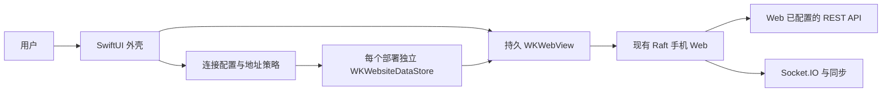

# Architecture v0.1

## 结构

只有 Web 发业务请求；外壳首版不复制 REST SDK、消息库或 token 刷新。外壳通过系统 WebKit 打开真实网页，页面内容随 Web 部署更新。

## 模块职责

| 模块 | 职责 |
|---|---|
| `ConnectionProfile` / `URLPolicy` | 规范化地址、限制方案、识别同源、决定导航去向 |
| `ConnectionStore` | 保存当前配置、部署到 dataStore UUID 的映射、可恢复路径；不存凭据 |
| `BrowserSession` | 长寿命 WKWebView、KVO 状态、加载错误、返回/重试、进程终止恢复 |
| `RaftWebView` | 把现有 WebView 挂到 SwiftUI；视图刷新不重建浏览器 |
| `ConnectionView` | 配置地址与输入错误；保留之前可用的连接 |
| `ShellView` | 加载/错误状态、轻量连接菜单、安全区域和应用生命周期 |

## App 图标

`App/Assets.xcassets/AppIcon.appiconset` 保存 1024px 不透明 PNG，使用项目独立生成的通用连接图标。Xcode 资产编译器生成系统需要的图标尺寸；不预裁圆角，不引入图片生成服务或运行时下载。

## 状态与生命周期

`未配置 → 编辑配置 → 加载 → 浏览`；加载失败进入 `可重试错误`，但保留配置和 Web 数据。

- “刷新”显式刷新网页，可能重置未保存页面状态，故不在每次前台恢复时自动执行。
- 进入后台不自行断开或维护 Socket；Web/iOS 决定暂停，返回前台交给现有 Web 的同步重连。
- WKWebView 必须保存在长寿命 `BrowserSession` 中，不随着 SwiftUI body/菜单变化重建。
- Web 内容进程被系统终止时，展示恢复入口或恢复最近的安全同源路径，避免死循环重载。
- 更换部署先结束旧浏览器，新的连接使用新部署的持久存储。旧部署登录留在其专属存储中。

## 登录与数据隔离

最低系统版本：**iOS 17**，采用 `WKWebsiteDataStore(forIdentifier:)` 对每个规范化 Web origin 建立独立持久存储。保留 Web 自身 token/cookie 管理，不将其导出到 UserDefaults、日志或分享面板。

原生不注入密码，不实现第二套刷新。注销使用 Web 原有注销；“清除当前连接数据”是独立操作，清理该 dataStore 后新建浏览器，不伪装成服务端撤销其他设备。

同一 origin 的多个 Raft 协作空间由 Web 管理，不人为分裂登录；不同 origin 的部署不会共享 cookie/localStorage。

## 地址与部署

首版配置一个 Web origin。输入完整 URL，或省略协议时补 HTTPS。HTTPS 支持域名/IPv4/IPv6/自定义端口；HTTP 仅限环回、明确的私有 IP 和本地名称。路径入口和恢复路由与 origin 分开，不把敏感 URL 存入配置。

API 可能与 Web 不同源，由该网页现有构建配置控制。首版不能靠 `window.location` 或拦截所有 fetch 来“替换 API”；那会让 REST、认证与 Socket 各走不同路径。若用户需要运行时 API 选择，增加显式 Web 环境合同，并在网页启动前验证和应用，另立 ADR。

## 原生与 Web 边界

连接后不占用顶部整条网址栏；角落连接菜单提供系统返回、刷新、改地址和清数据。WKWebView 延伸至容器底部，由 Web 的 safe-area 处理底部导航；键盘安全区域仍由 SwiftUI 处理。UIKit 的自动 scroll inset 关闭，避免再次扣掉 home indicator 高度。Web 拥有产品导航。首版不注入 `window.RaftHost`。未来需要原生事件时，另行定义单向事件合同。不要注入 `__TAURI_INTERNALS__` 或冒充 Desktop 环境，否则会触发官网生产/staging 地址验证。

普通同源导航留在 WebView。外部普通链接交给系统浏览器；网页新窗口按链接策略处理；OAuth 不能沿用普通外链处理声称已经支持。未知 scheme 不执行，系统电话/邮件链接由明确列表允许。

首版没有原生事件桥，不从网页接收任意原生命令、目标地址或凭据。

## 失效与诊断

- 初次导航非成功 HTTP 状态、DNS/连接失败、证书错误都显示可重试提示；不自动删除登录。
- iOS 正常处理 TLS 验证，不能通过接受所有 authentication challenge 绕过证书。
- 诊断只记录状态与错误分类，不记录 URL 查询参数、请求正文或身份 token。
- 使用受控测试网页验证外壳；真实 Raft 联调使用用户指定部署，不替其部署前端或修改生产配置。

## 推送扩展

后续 `PushCoordinator` 负责通知授权、设备 token 和点击路由；后端负责注册、撤销、APNs 投递。若用户只拥有官网协作空间，需要先确认平台允许个人 App 的推送身份；不可直接复用官方 App 的签名/推送凭据。

## 参考接口

外壳不包含 Raft 服务端或 Web 源码。下列上游模块用于理解兼容边界：

- `packages/web/src/store/mobileNavStore.ts`、`components/layout/LeftRail.tsx`：手机导航。
- `packages/web/src/api/client.ts`、`api/socket.ts`、`desktopRuntimeEnvironment.ts`：REST/Socket 地址和 Web token 所有权。
- `packages/web/src/embed/hostBridge.ts`：`raft-host-v1` 事件合同。
- `packages/web/h5-bundle.config.json`：hosts 为空，不能宣称离线原生资源包就绪。
- `packages/server/src/routes/push.ts`、`services/pushService.ts`：原生推送注册/撤销/APNs 配置和功能开关。

Apple：[WebKit 数据存储](https://developer.apple.com/documentation/webkit/wkwebsitedatastore)、[WKNavigationDelegate](https://developer.apple.com/documentation/webkit/wknavigationdelegate)。
